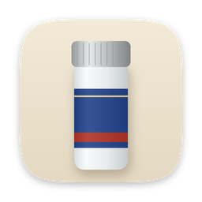

# Pervitin

Keeps your Mac awake for as long as you say. Nothing else.

Made by protowaldganger.

## Install

1. Download `Pervitin.dmg` from [the latest release](../../releases/latest), open it and drag Pervitin onto Applications.
2. Open it. macOS warns that it cannot verify the developer, because the app is not notarized. Open System Settings › Privacy & Security, scroll down and click Open Anyway.

Requires macOS 13 or later. Universal: Apple silicon and Intel. 448 KB.

## Use

- Click the tube in the menu bar and tap a length: 15 minutes to 8 hours, or ∞ until you stop it. It starts at once.
- For a time of day, tap Until, pick the time and press Keep awake.
- The tube drains as the session runs down. Hover it for the exact time left.
- A short sound plays when it switches on and off. It uses sounds built into macOS, so the app ships none.
- Right-click the tube to start or stop instantly with the last length you picked.
- By default the display stays on and the screen saver stays away. Turn on "Let the display sleep" to keep only the Mac itself awake.

Closing the lid still puts a MacBook to sleep, as macOS intends.

## Private by design

No analytics, no tracking, sandboxed. It holds the same power assertions as macOS's own `caffeinate`, and the only thing it stores is your choices. It goes online only if you turn on Check for updates (off by default). Then it asks GitHub once a day which release is newest, with no cookies and nothing about your Mac, and shows a link if there is a newer one. Nothing downloads by itself.

## Build

Requires Xcode.

```
zsh build.sh
```

This makes `build/Pervitin.app` and `build/Pervitin.dmg`.

## Uninstall

```
rm -rf /Applications/Pervitin.app
rm -rf ~/Library/Containers/com.protowaldganger.pervitin
```
